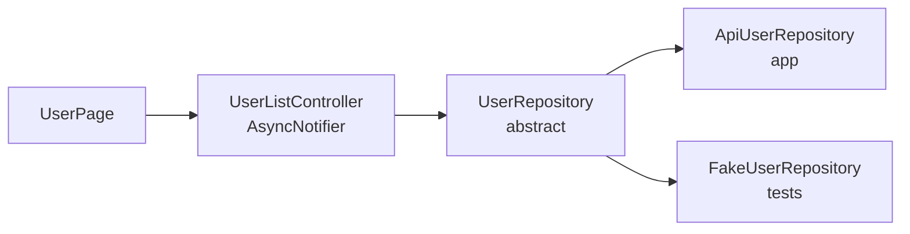

# user_list_test

A small Flutter feature that fetches a list of users through a repository layer,
with unit tests written with Riverpod (`AsyncNotifier`) and a hand-written fake
repository. No mock library and no code generation.

## What it does

- Loads users from `https://dummyjson.com/users` and shows them in a list.
- Shows a spinner while loading, and an error message with a **Try again** button on failure.
- Has two bottom tabs: **Home** (the user list) and **Profile** (empty for now).
- The unit tests never call the network. They replace the repository with a fake.

## How the pieces connect



The controller only knows the abstract `UserRepository`. The app gives it the real
one, and a test overrides `userRepositoryProvider` with the fake.

## Folder structure

Feature-first, with one folder per layer.

```
lib/
  main.dart                                  # theme (deep blue) + app start
  features/
    home/presentation/home_page.dart         # bottom tabs: Home, Profile
    profile/presentation/profile_page.dart   # empty page
    user/
      domain/user.dart                       # User model
      data/user_repository.dart              # UserRepository, ApiUserRepository, provider
      application/user_list_controller.dart  # AsyncNotifier<List<User>>
      presentation/user_page.dart            # list page
test/
  features/
    home/presentation/home_page_test.dart    # widget tests for the tabs
    user/
      fake_user_repository.dart              # 5 fake users + FakeUserRepository
      application/user_list_controller_test.dart
```

## The tests

| Test | The fake does | Expected states |
|---|---|---|
| `fetch users success` | returns 5 users | `AsyncLoading` → `AsyncData` with the 5 users |
| `fetch users failure` | throws an exception | `AsyncLoading` → `AsyncError` with that exception |

Both tests also check that the repository was called exactly once.

Three widget tests use the same fake: the Home tab shows the 5 users, the
Profile tab is empty, and the app bar and tab bar use the deep blue color.

### The fake

```dart
class FakeUserRepository implements UserRepository {
  FakeUserRepository({this.users = const [], this.error});

  final List<User> users;
  final Exception? error;
  int fetchCount = 0;

  @override
  Future<List<User>> fetchUsers() async {
    fetchCount++;

    final error = this.error;
    if (error != null) {
      throw error;
    }

    return users;
  }
}
```

### Why retry is turned off in tests

Riverpod 3 retries a failed provider by default. The test container sets
`retry: (retryCount, error) => null`, so the failure test ends right after the
first error instead of waiting for the retries.

## Run it

Flutter 3.47.7 (pinned with FVM in `.fvmrc`), `flutter_riverpod` 3.5.0, `dio` 5.11.1.

```bash
fvm flutter pub get
fvm flutter test
fvm flutter run
```

Without FVM, use `flutter` in place of `fvm flutter`.
