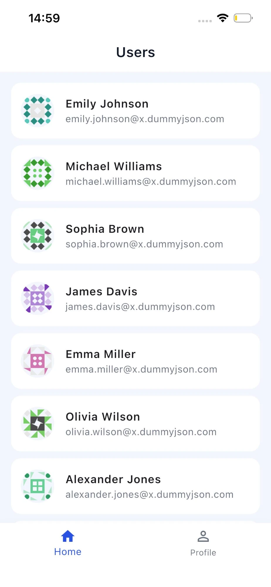
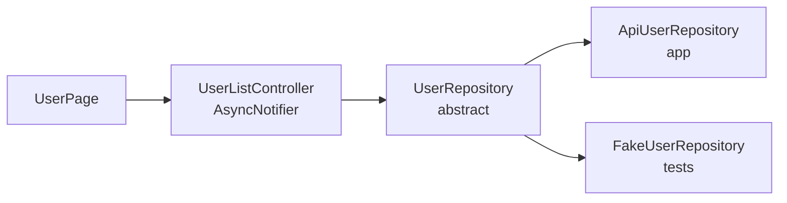

# user_list_test

A Flutter user list built with a feature-first approach and a repository
layer, tested with Riverpod `AsyncNotifier` and a hand-written fake repository.
No mock library, no code generation.



## Features

- Users from `https://dummyjson.com/users`
- Loading, error (with retry) and data states
- Home and Profile tabs

## How the pieces connect



## Structure

Feature-first: each feature has its own folder, split into layers.

```
lib/features/
  home/presentation/       # bottom tabs
  profile/presentation/    # empty page
  user/
    domain/                # User model
    data/                  # UserRepository + API implementation
    application/           # UserListController (AsyncNotifier)
    presentation/          # list page
test/features/
  home/presentation/       # widget tests
  user/                    # fake repository + controller tests
```

## Tests

| Test | Fake repository | Expected states |
|---|---|---|
| `fetch users success` | returns 5 users | loading → data |
| `fetch users failure` | throws an exception | loading → error |

The tests override `userRepositoryProvider` with `FakeUserRepository`, so they
never call the network.

## Run

```bash
fvm flutter pub get
fvm flutter test
fvm flutter run
```

Flutter 3.47.7 · flutter_riverpod 3.5.0 · dio 5.11.1
